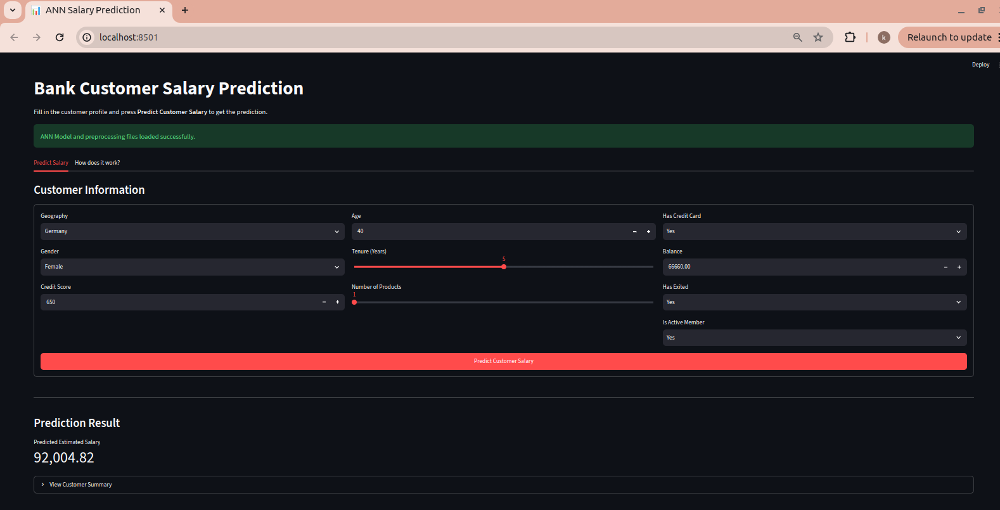
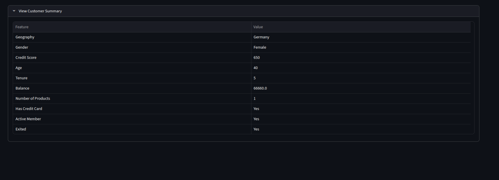
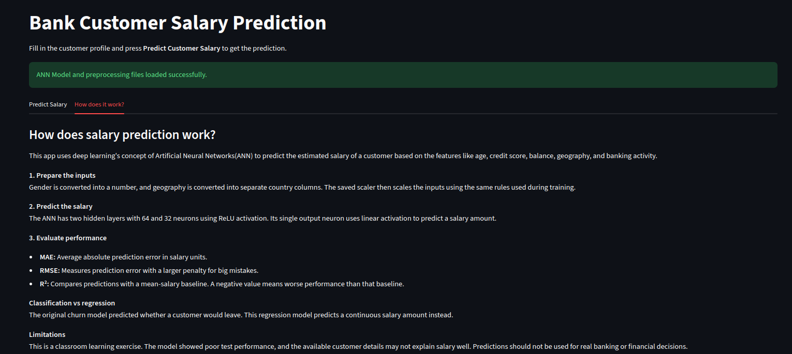

# ANN Salary Prediction

## Problem and Dataset
This classroom project converts bank customer churn classification into regression to predict `EstimatedSalary`. It uses `Churn_Modelling.csv`, containing 10,000 customer records. The predictions are a learning exercise, not a reliable salary-estimation service.

## Features and Preprocessing
Inputs are CreditScore, Geography, Gender, Age, Tenure, Balance, NumOfProducts, HasCrCard, IsActiveMember, and Exited. EstimatedSalary is the target and is excluded from the inputs. RowNumber, CustomerId, and Surname are removed as identifiers.

Data is split into 64% training, 16% validation, and 20% testing. Gender uses LabelEncoder, Geography uses OneHotEncoder, and inputs use StandardScaler. All preprocessing objects are fitted only on training data and reused for validation, testing, and app predictions. The app restores the training feature order before scaling.

## Architecture
The ANN uses 12 encoded inputs, hidden layers of 64 and 32 neurons with ReLU activation, and one linear output neuron. It trains with Adam (learning rate 0.01), MAE loss, and up to 100 epochs. Early stopping monitors validation loss with patience 10 and restores the best weights.

Unlike churn classification, this model predicts a continuous amount rather than a class or probability. It uses linear output and regression loss instead of sigmoid output and binary cross-entropy.

## Evaluation
Recorded test results from one training run:

| Metric | Result |
| --- | ---: |
| MAE | 50,404.43 |
| RMSE | 58,354.70 |
| R² | -0.0315 |

MAE is the average absolute error in salary units. RMSE gives more weight to large errors. Negative R² means worse squared-error performance than predicting the test set's mean salary. Results can vary between training runs.

## Project Files
- `salary_prediction.ipynb`: data exploration, preprocessing, training, and evaluation.
- `Churn_Modelling.csv`: classroom dataset.
- `app.py`: Streamlit application.
- `model.h5`: trained salary model.
- `label_encoder_gender.pkl`, `onehot_encoder_geo.pkl`, `scaler.pkl`: fitted preprocessing objects.
- `requirements.txt`: Python dependencies.
- `prediction_tab.png`, `summary.png`, `how_it_works_tab.png`: app screenshots.

## Run Locally
Install dependencies from the project folder:

```bash
pip install -r requirements.txt
```

To train, open `salary_prediction.ipynb` in VS Code or Jupyter, select the Python environment, and run all cells in order. Keep `Churn_Modelling.csv` in the project folder.

To launch the app:

```bash
streamlit run app.py
```

Keep the model and all three preprocessing files together with `app.py`. Use artifacts from the same salary-training run.

## Deploy
Upload the project to GitHub, including `app.py`, `requirements.txt`, the notebook, model, preprocessing files, and screenshots. In Streamlit Community Cloud, create an app from the repository, select its branch and `app.py`, and deploy. Use compatible Python and package versions with those used for training.

## Limitations
Test errors are large, and the model has limited predictive usefulness. The available customer details may not adequately explain salary; factors such as occupation and education are absent. Exited is included for this exercise but may be unavailable when predicting a current customer's salary. Salary currency and time period must follow the dataset's definitions. Linear output can produce negative values, and inputs outside the training range may give unreliable results. This model should not guide real banking decisions.

## Screenshots

### Salary Prediction


### Customer Summary


### How It Works

